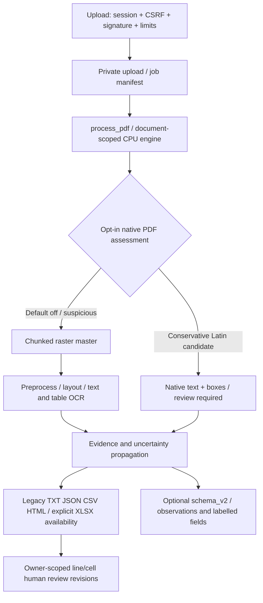

# معماری و قراردادهای اصلاحات OCR

وضعیت: **PARTIAL؛ ویژه سورس توسعه W، بدون استقرار**. سند مأموریت مرحله دوم و ممیزی قبلی مبنا هستند؛ محدودیت مستقیم کاربر درباره عدم تغییر P و محرمانگی بر هر دستور اجرایی مقدم است.

## دو نسخه مستقل

| مؤلفه | W پس از اصلاح | P فعال، صرفاً مقایسه |
|---|---|---|
| موتور اصلی | Tesseract بومی CPU؛ DLL pool و CLI محدود | Tesseract بومی legacy |
| مدل فارسی/انگلیسی | fas/eng نصب‌شده با SHA-256 ثابت در local_models.py | همان artifactهای نصب‌شده؛ تغییر نکرد |
| serve.py | configure_storage از تابع مستقل P تطبیق داده شد؛ storage/TEMP خصوصی پیش از import | مسیرهای خصوصی E و release مستقل |
| render.py | رندر قطعه‌ای و probe صفحه سفید P منتقل و تطبیق پیکسل آزموده شد | رندر قطعه‌ای |
| quality.py و precision/ | **ادغام نشده**؛ معادل‌سازی فایل هم‌نام انجام نشده | quality و مسیر candidate اختصاصی |
| precision.py | مسیر اختیاری موتور دوم؛ نصب محلی آن موجود نیست | فایل هم‌ارز ندارد؛ precision/ موتور Tesseract است |
| بازبینی | سطر/سلول نسخه‌دار W، مالکیت و CSRF | routes و snapshotهای متفاوت P |
| Excel | mandatory در API سطح پایین؛ حالت تنزل صریح در OCR و review | قرارداد متفاوت؛ مستند ممیزی |

سازگاری کامل `/reviews`، previewهای index-based، handwriting declaration، search و active revision در P با W **BLOCKED_INTEGRATION** است. حفظ routes فعلی W به معنی حفظ همه APIهای P نیست. هیچ فایل P کپی دسته‌ای یا اجرا نشده است؛ تنها توابع مستقل storage و renderer پس از بررسی منتقل شدند.

## مسیر داده W

هیچ دیتابیس تجاری یا اتصال به سامانه اصلی ساخته نشده است. callable مستقل cross_document کنترل دسترسی نیست؛ adapter آینده باید scope پرونده مجاز را در سمت سرور احراز کند.

## قرارداد افزوده schema_v2

فعال‌سازی توسعه: `OCR_SCHEMA_V2=1`. حالت پیش‌فرض خاموش است؛ خروجی‌های legacy حفظ می‌شوند. `OCR_DOCUMENT_SCHEMA=common_labeled_v1` فقط استخراج برچسب صریح را انتخاب می‌کند؛ مقدار نامشخص `UNSUPPORTED_DOCUMENT_SCHEMA` می‌دهد. این تنظیم classifier نیست.

هر observation فیلدهای document_id، page، source_bbox، region_id، field_name، raw_ocr_text، logical_text، display_text، canonical_value، value_type، unit، candidates، recognizer، model_hash، uncertainty_reasons، validation_results، review_status، human_review_revision و provenance دارد. شناسه سند hash فایل است؛ نام مشتری لازم نیست. SHA raw و source_digest منشأ را ثبت می‌کنند، اما امضای دیجیتال یا اثبات اصالت سند نیستند.

| لایه | قرارداد |
|---|---|
| raw | مشاهده OCR بدون اصلاح؛ در snapshot اولیه باقی می‌ماند |
| logical | متن منتخب با ترتیب منطقی؛ اصل کلمات و منبع انتخاب حفظ می‌شوند |
| display | نمایش فارسی و یکسان‌سازی ی/ک و ارقام؛ برای شناسه canonical استفاده نمی‌شود |
| canonical | فقط NFC و ارقام ASCII برای متن/شناسه؛ صفر ابتدایی، فاصله، slash، hyphen و علامت حفظ می‌شوند؛ Decimal فقط با قرارداد جداکننده صریح |
| validation | نتیجه قاعده با version/context/limit؛ مستقل از بازبینی |
| review | observed، uncertain، missing یا unreadable؛ هیچ اجرای خودکار human_confirmed نمی‌سازد |

`observations` مشاهدات کلمه/سلول را نگه می‌دارد؛ `line_observations` منبع منتخب استخراج است. در maximum_local، اگر final_text_source برابر review_units باشد، همان واحدها منبع منتخب هستند؛ کلمات Tesseract قدیمی فقط شواهد جدا باقی می‌مانند. `regional_evidence` خوانش‌های ناحیه را بدون تکثیر نامحدود ذخیره می‌کند. candidates تا ۸ و تاریخچه تا ۱۶ محدودند؛ تجاوز بودجه با دلیل صریح همراه است.

مختصات source_bbox برحسب پیکسل تصویر اصلی در effective_dpi است، نه point PDF. نگاشت معکوس deskew با آزمون affine پوشش داده شده؛ برش/چرخش PDF در مسیر native آزمایشی پذیرفته نمی‌شود. deskew در خطر قطع جوهر اجرا نمی‌شود و عملیات skipped ثبت می‌شود. bbox فیلد مشترک محدوده «برچسب و مقدار» است، نه ادعای مختصات دقیق هر نویسه.

بازبینی انسانی موجود سطر/سلول است. schema_v2 در نسخه بازبینی‌شده با `stale_after_human_review` و `fields_current=false` برچسب می‌خورد؛ structured publication متناظر با revision انسانی **NOT_IMPLEMENTED** است. snapshot خودکار را نباید داده نهایی تجاری تلقی کرد؛ commercial_registration_allowed همیشه false است. هیچ endpoint تجاری جدیدی ایجاد نشده است.

## اعتبارسنجی و پشتیبانی سند

validators.py فقط نتیجه برمی‌گرداند: check digit کانتینر در scope صریح ISO 6346، شکل HS با context، Gregorian با datetime، Decimal، net/gross، جمع سطر با تخفیف/هزینه/مالیات و tolerance صریح، شناسه دارای rule ثبت‌شده و مقایسه scopeدار چند سند. وزن با واحد متفاوت، نبود داده، نبود تقویم/locale یا نبود مرجع ملی نتیجه نامطمئن/محاسبه‌نشده دارد؛ مقدار OCR overwrite نمی‌شود. Jalali: BLOCKED_DEPENDENCY.

منابع عمومی قواعد: [BIC identification](https://www.bic-code.org/identification-number/)، [ISO annex outline](https://www.iso.org/obp/ui?_escaped_fragment_=iso%3Astd%3Aiso%3A6346%3Adis%3Aed-5%3Av1%3Aen)، [WCO HS FAQ](https://www.wcoomd.org/en/faq/harmonized_system_faq.aspx). این مراجعه فقط درباره استاندارد عمومی بود؛ داده سندی ارسال نشد. HS طول معتبر مساوی عضویت واقعی در nomenclature یا صحت طبقه‌بندی نیست.

هشت خانواده هدف (اظهارنامه/ترخیص؛ Invoice/Proforma؛ Packing List؛ CMR/بارنامه؛ مبدأ؛ کانتینر/حمل؛ بانکی/بیمه/پرداخت؛ قوانین/بخشنامه) فعلاً adapter تأییدشده ندارند: **UNSUPPORTED_DOCUMENT_SCHEMA / NOT_MEASURED**. registry مشترک هشت فیلد document_number، date، container، net_weight، gross_weight، currency، amount و hs دارد. نیازمندی API سامانه اصلی، schema واقعی کشور، احراز مجوز پرونده و corpus مجاز همچنان باز است.

سیاست نهایی رندر: صفحات تک‌تصویری بدون متن/بردار، حتی با حاشیه سفید وسیع، در سقف پیکسل موجود با sampling کامل رندر می‌شوند؛ در رندر سفیدِ ناسازگار با probe، fallback قطعه‌ای اجرا می‌شود. صفحات برداری/ترکیبی بزرگ همچنان قطعه‌ای‌اند. دلیل این تطبیق، پسرفت OCR اثبات‌شده از resampling تصویر در clipهای مجزا بود، نه فرض هم‌ارزی P/W.
